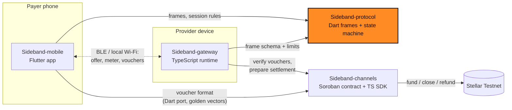

<div align="center">


# Sideband Protocol

**Transport-agnostic session protocol for nearby, metered services.**

Part of [Sideband](#how-sideband-works): nearby services, metered value, Stellar settlement.

[](https://github.com/Sideband34/Sideband-protocol/actions/workflows/ci.yml)
[](./LICENSE)
[](#status)
[](./SECURITY.md)

[How it works](#how-sideband-works) · [Quickstart](#quickstart) · [Status](#status) · [Architecture](#architecture) · [Contributing](#contributing) · [Security](#security)

</div>

> [!WARNING]
> Pre-release software for **Stellar Testnet and synthetic assets only**. The channel contract and
> voucher format are **unaudited**. Do not use with real funds.

## What this repository is

A pure Dart package that defines how a payer and a provider talk during a Sideband session, with
no UI, no networking stack of its own and no payment cryptography:

- **Versioned frames** (`service_offer`, `session_accept`, `meter_sample`, `voucher`,
  `session_close`, `error`) with strict decoding, size limits and canonical JSON.
- **Fixed-point `Amount`** (7 decimals, integer arithmetic; no floats).
- **`SessionMachine`**: offer/accept validation, one-time nonces, monotonic voucher enforcement,
  meter checks.
- **`UsageMeter`** and a **`Transport` / `FrameChannel` contract** with retry and backpressure,
  plus an in-memory loopback for tests.

Signature verification and voucher signing belong to
[Sideband-channels](https://github.com/Sideband34/Sideband-channels); call `commitVoucher` only after the signature has
been verified there.

## Quickstart

Requires the Dart SDK 3.5+.

```bash
git clone https://github.com/Sideband34/Sideband-protocol && cd Sideband-protocol
dart pub get
dart analyze && dart test
dart run example/loopback.dart     # payer and provider over the in-memory loopback
```

Use it from another package:

```yaml
dependencies:
  sideband_protocol:
    git:
      url: https://github.com/Sideband34/Sideband-protocol.git
      ref: main
```

## Status

| Area | Status |
|---|---|
| Frames, canonical encoding, size limits | Implemented, tested |
| Session state machine, nonce replay, monotonic vouchers | Implemented, tested |
| Usage meter, transport contract, loopback | Implemented, tested (27 tests) |
| BLE transport adapter | Not started: needs physical-device testing |
| Local Wi-Fi / Wi-Fi Direct adapter | Not started |
| Signature checks | Out of scope here (owned by Sideband-channels) |
| Published package on pub.dev | No (consumed as a git dependency) |

Consumers: [Sideband-mobile](https://github.com/Sideband34/Sideband-mobile) (frames, `SessionMachine`, `Amount`) and
[Sideband-gateway](https://github.com/Sideband34/Sideband-gateway) (frame field names and limits, v1).

## How Sideband works

Sideband lets a phone pay a nearby device for a small metered service (for example, text
processing priced per word) over Bluetooth LE or local Wi-Fi, without needing the internet during
the session:

1. **Fund a channel (online).** The payer deposits a Testnet asset into a Soroban payment channel
   bound to one provider.
2. **Discover nearby.** Devices find each other locally, verify the provider's signed service
   manifest, and agree on price, units and a spending cap.
3. **Stream with signed vouchers (offline).** Each metered unit is paid with a cumulative,
   domain-separated voucher signed on the phone. The provider verifies it locally and rejects
   replays and rollbacks.
4. **Settle later (online).** The provider submits its highest voucher on-chain; the rest of the
   deposit is refundable to the payer after expiry.

A voucher is a commitment against already-locked funds, **not** a completed payment. Nothing is
shown as settled until Stellar confirms it.

## Architecture

Four repositories, one responsibility each. No payment signing lives in transport code, and no
chain logic lives in the app. This repository is highlighted.



| Repository | Stack | Responsibility |
|---|---|---|
| [Sideband-mobile](https://github.com/Sideband34/Sideband-mobile) | Flutter | Payer app: discovery UX, spend limits, voucher signing, history and receipts |
| [**Sideband-protocol**](https://github.com/Sideband34/Sideband-protocol) | Dart | Versioned session frames, canonical encoding, session state machine, metering, transport contract |
| [Sideband-gateway](https://github.com/Sideband34/Sideband-gateway) | TypeScript | Provider runtime: signed manifest, metered service, anti-replay voucher validation, settlement prep, landing site |
| [Sideband-channels](https://github.com/Sideband34/Sideband-channels) | Rust · TypeScript | Soroban payment channel contract, cumulative voucher format, channel adapters, settlement intents |

Cross-repo contracts are pinned with fixtures: voucher golden vectors from `Sideband-channels`,
and a synthetic session transcript from `Sideband-gateway`. See
[`docs/ARCHITECTURE.md`](./docs/ARCHITECTURE.md) for data and ownership paths.

## Contributing

Contributions are welcome. Start with [CONTRIBUTING.md](./CONTRIBUTING.md) for the local checks and
workflow, and pick from the scoped work in
[docs/CONTRIBUTOR_ISSUES.md](./docs/CONTRIBUTOR_ISSUES.md): each item lists its interfaces,
acceptance tests and size. Please follow the [Code of Conduct](./CODE_OF_CONDUCT.md).

**Drips Wave.** Sideband intends to participate in
[Drips Wave](https://docs.drips.network/wave/maintainers/participating-in-a-wave/) on Stellar.
Participation and rewards depend on organizer approval and are not guaranteed. Wave issues are
real, scoped work in this repository's boundary, never filler.

## Security

Please report vulnerabilities privately; see [SECURITY.md](./SECURITY.md). The threat model is
in [docs/SECURITY.md](./docs/SECURITY.md). Never post keys or seeds in issues, even Testnet ones.

## Project documents

[PRD](./docs/PRD.md) · [Requirements](./docs/SRD.md) · [Architecture](./docs/ARCHITECTURE.md) ·
[Stellar protocol](./docs/STELLAR_PROTOCOL.md) · [Roadmap](./docs/ROADMAP.md) ·
[Brand](./docs/BRAND.md) · [Agent rules](./AGENTS.md)

The approved logo is in [`brand/`](./brand) and shared by all four repositories.

## License

[MIT](./LICENSE)
