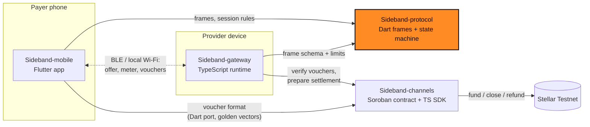

<div align="center">


# Sideband Protocol

**Transport-agnostic session protocol for nearby, metered services.**

Part of [Sideband](#how-sideband-works): nearby services, metered value, Stellar settlement.

[](https://github.com/Sideband34/Sideband-protocol/actions/workflows/ci.yml)
[](./LICENSE)
[](#status)
[](./SECURITY.md)
[](https://github.com/Sideband34/Sideband-gateway/blob/main/gitbook/README.md)
[](https://github.com/Sideband34/Sideband-protocol/issues?q=is%3Aissue+is%3Aopen+label%3A%22Stellar+Wave%22)

[Docs](https://github.com/Sideband34/Sideband-gateway/blob/main/gitbook/README.md) · [Live site](https://sideband-web1.vercel.app) · [Quick start](#quick-start) · [Status](#status) · [Architecture](#how-it-fits-together) · [Contributing](#contributing) · [Security](#security)

</div>

> [!WARNING]
> Pre-release software for **Stellar Testnet and synthetic assets only**. The channel contract and
> voucher format are **unaudited**. Do not use with real funds.

## What this is

Sideband-protocol is the shared language of a Sideband session. When a phone and a nearby provider agree on a price, count the units used and exchange signed payment promises, they send each other the frames defined here. It is a small Dart library with strict decoding, size limits and a state machine that rejects replayed, reordered or over-budget messages. It has no UI, no networking stack and no payment cryptography of its own.

What is inside:

- **Versioned frames** (`service_offer`, `session_accept`, `meter_sample`, `voucher`,
  `session_close`, `error`) with strict decoding, size limits and canonical JSON. Protocol v2
  adds `session_accept.baseline` so several sequential sessions can share one funded channel
  ([ADR 0001](docs/adr/0001-session-baseline.md)); v1 frames still decode.
- **Fixed-point `Amount`** (7 decimals, integer arithmetic; no floats).
- **`SessionMachine`**: offer/accept validation, one-time nonces, per-session budgets measured
  from the channel baseline, monotonic voucher enforcement, meter checks.
- **`UsageMeter`** and a **`Transport` / `FrameChannel` contract** with retry and backpressure,
  plus an in-memory loopback for tests.

Signature verification and voucher signing belong to
[Sideband-channels](https://github.com/Sideband34/Sideband-channels); call `commitVoucher` only after the signature has
been verified there.

The full frame and session reference is in [docs/PROTOCOL.md](./docs/PROTOCOL.md).

## Quick start

Requires the Dart SDK 3.5+.

```bash
git clone https://github.com/Sideband34/Sideband-protocol && cd Sideband-protocol
dart pub get
dart analyze && dart test
dart run example/loopback.dart     # payer and provider over the in-memory loopback
```

Use it from another package:

```yaml
dependencies:
  sideband_protocol:
    git:
      url: https://github.com/Sideband34/Sideband-protocol.git
      ref: main
```

## Status

| Area | Status |
|---|---|
| Frames, canonical encoding, size limits | Implemented, tested |
| Session state machine, nonce replay, monotonic vouchers | Implemented, tested |
| Protocol v2: `session_accept.baseline`, several sessions per channel | Implemented, tested ([ADR 0001](docs/adr/0001-session-baseline.md)) |
| Usage meter, transport contract, loopback | Implemented, tested (37 tests in total) |
| BLE and LAN transport adapters | In Sideband-mobile (Flutter plugins): unit-tested with fakes, **untested on hardware** |
| Transport-level session resume frame | Not started (the payer resumes over the gateway API today) |
| Signature checks | Out of scope here (owned by Sideband-channels) |
| Published package on pub.dev | No (consumed as a git dependency) |

Consumers: [Sideband-mobile](https://github.com/Sideband34/Sideband-mobile) (frames, `SessionMachine`, `Amount`) and
[Sideband-gateway](https://github.com/Sideband34/Sideband-gateway) (frame field names and limits, v1 + v2 accept).

## How Sideband works

Sideband lets a phone pay a nearby device for a small metered service (for example, text
processing priced per word) over Bluetooth LE or local Wi-Fi, without needing the internet during
the session:

1. **Fund a channel (online).** The payer deposits a Testnet asset into a Soroban payment channel
   bound to one provider.
2. **Discover nearby.** Devices find each other locally, verify the provider's signed service
   manifest, and agree on price, units and a spending cap.
3. **Stream with signed vouchers (offline).** Each metered unit is paid with a cumulative,
   domain-separated voucher signed on the phone. The provider verifies it locally and rejects
   replays and rollbacks.
4. **Settle later (online).** The provider submits its highest voucher on-chain; the rest of the
   deposit is refundable to the payer after expiry.

A voucher is a commitment against already-locked funds, **not** a completed payment. Nothing is
shown as settled until Stellar confirms it.

## How it fits together

Four repositories, one responsibility each. No payment signing lives in transport code, and no
chain logic lives in the app. This repository is highlighted.



| Repository | Stack | Responsibility |
|---|---|---|
| [Sideband-mobile](https://github.com/Sideband34/Sideband-mobile) | Flutter | Payer app: discovery UX, spend limits, voucher signing, history and receipts |
| [**Sideband-protocol**](https://github.com/Sideband34/Sideband-protocol) | Dart | Versioned session frames, canonical encoding, session state machine, metering, transport contract |
| [Sideband-gateway](https://github.com/Sideband34/Sideband-gateway) | TypeScript | Provider runtime: signed manifest, metered service, anti-replay voucher validation, settlement prep, landing site |
| [Sideband-channels](https://github.com/Sideband34/Sideband-channels) | Rust · TypeScript | Soroban payment channel contract, cumulative voucher format, channel adapters, settlement intents |

Cross-repo contracts are pinned with fixtures: voucher golden vectors from `Sideband-channels`,
and a synthetic session transcript from `Sideband-gateway`. See
[`docs/ARCHITECTURE.md`](./docs/ARCHITECTURE.md) for data and ownership paths.

## Tech stack

| Layer | Technology |
|---|---|
| Language | Dart 3.5 or newer, no Flutter dependency |
| Tests | `package:test` (37 tests), `dart analyze --fatal-infos`, `dart format` |
| Consumers | Sideband-mobile (git dependency), frame names mirrored in Sideband-gateway |

## Project structure

```
lib/src/frames/      frames, canonical JSON, fixed-point Amount
lib/src/handshake/   SessionMachine (offer, accept, vouchers, meter checks)
lib/src/metering/    UsageMeter
lib/src/transport/   Transport interface, loopback, FrameChannel with retries
docs/PROTOCOL.md     the wire and session contract
docs/adr/            architecture decisions
example/             payer and provider over the loopback
test/                unit tests for each area
```

## Contributing

Contributions are welcome. Start with [CONTRIBUTING.md](./CONTRIBUTING.md) for the local checks and the workflow, then pick an open issue labelled
[`Stellar Wave`](https://github.com/Sideband34/Sideband-protocol/issues?q=is%3Aissue+is%3Aopen+label%3A%22Stellar+Wave%22). Each issue lists context, scope, implementation notes and
acceptance criteria, and carries a `trivial`, `medium` or `high` complexity label. New here? Try [`good first issue`](https://github.com/Sideband34/Sideband-protocol/issues?q=is%3Aissue+is%3Aopen+label%3A%22good+first+issue%22).
Please follow the [Code of Conduct](./CODE_OF_CONDUCT.md).

**Drips Wave.** Sideband applies to [Drips Wave](https://docs.drips.network/wave) on Stellar. Acceptance and rewards depend on the organizers and are not guaranteed.

## Security

Report vulnerabilities privately, as described in [SECURITY.md](./SECURITY.md). The threat model and what is not covered are in [docs/SECURITY.md](./docs/SECURITY.md).
This is a Testnet prototype and has not been audited. Never post keys or seeds in an issue, even Testnet ones.

## Community

Questions and ideas: [GitHub Discussions](https://github.com/Sideband34/Sideband-protocol/discussions).
<!-- Owner: add the community invite link (Telegram or Discord) on this line when it exists. -->

## Maintainers

| Maintainer | Role | Contact |
|---|---|---|
| [Cjay-Cyber-2](https://github.com/Cjay-Cyber-2) | Maintainer | GitHub [issues](https://github.com/Sideband34/Sideband-protocol/issues) and [Discussions](https://github.com/Sideband34/Sideband-protocol/discussions) |

## Contributors

<a href="https://github.com/Sideband34/Sideband-protocol/graphs/contributors">
  
</a>

## License

[MIT](./LICENSE)
